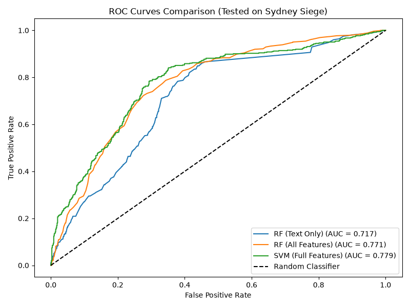
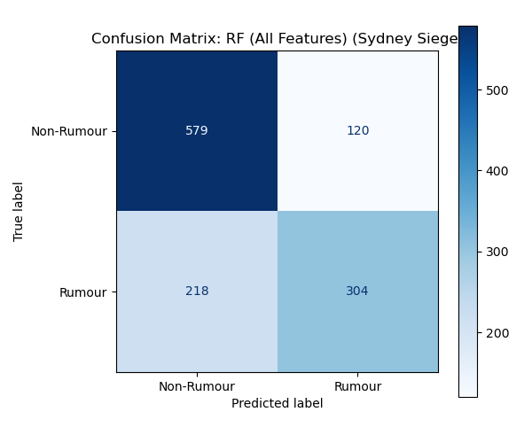
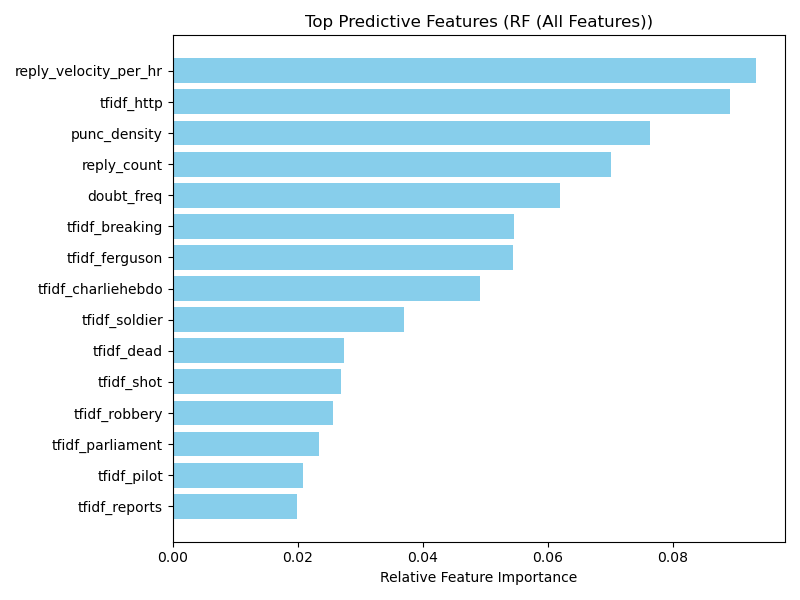

# Rumour vs Non-Rumour Classification

**Early detection of rumours on Twitter using the PHEME dataset**

CM3070 Final Project, BSc Computer Science, University of London.
Project template: *Predictive Modelling of Social Media Trend Emergence*.

## Overview

This project classifies Twitter conversation threads as **rumour** or **non-rumour** using only what is visible in the
first **4 hours** after the source tweet. The goal is to flag likely misinformation for review before it goes viral.
On top of the classifier, a **Trend Emergence Score** ranks threads by combined rumour probability, reply velocity and
scepticism, so the highest-risk threads can be triaged first.

## Results

Models were trained on four events and tested on an **unseen event** (Sydney Siege, 1,221 threads):

| Model | Accuracy | Macro Precision | Macro Recall | Macro F1 |
|---|---|---|---|---|
| Random Forest (text only) | 0.688 | 0.681 | 0.675 | 0.677 |
| **Random Forest (all features)** | **0.723** | **0.722** | **0.705** | **0.708** |
| SVM (all features) | 0.663 | 0.701 | 0.618 | 0.599 |

**Best model: Random Forest with text and conversation features, macro F1 = 0.71, accuracy = 72%.**
Adding the reply-based features raised macro F1 by about 3 points over text alone.
With a threshold of 0.65, the Trend Emergence Score flagged 15 of the 1,221 test threads for priority triage.

| ROC curves | Confusion matrix | Top features |
|---|---|---|
|  |  |  |

## Methods

**Features.** Each thread is described by three groups of features, all taken from the first 4 hours:

- **Text of the source tweet.** TF-IDF (top 500 terms, English stop words removed), reduced to the 50 most
  informative terms with `SelectKBest` (ANOVA F-test).
- **Scepticism in replies.** The share of `?` and `!` marks per word, and how often doubt words appear per word
  (for example *fake*, *hoax*, *unconfirmed*, *source*, *really*).
- **Reply activity.** The number of replies and the replies per hour within the window.

Numerical features are standardised with `StandardScaler`.

**Models.** All from scikit-learn:

- Random Forest (100 trees) on text features only, as the baseline
- Random Forest (100 trees) on all features
- SVM (RBF kernel) on all features

**Evaluation.** The split is by event, not random. Training uses Charlie Hebdo, Ferguson, Germanwings and Ottawa
Shooting (4,581 threads). Testing uses Sydney Siege (1,221 threads). This checks whether the model works on a news
event it has never seen. Metrics are macro-averaged, so both classes count equally.

**Trend Emergence Score.** For the test threads, the score is
`0.50 × rumour probability + 0.35 × reply velocity + 0.15 × scepticism`.
Reply velocity is log-scaled and min-max normalised. Scepticism is min-max normalised. Threads scoring at least 0.65
raise a pre-viral alert.

## Dataset

[PHEME dataset for Rumour Detection and Veracity Classification](https://doi.org/10.6084/m9.figshare.4010619)
(Zubiaga et al.). It is not stored in this repo because of its size.

**5,802 threads** from five breaking-news events, labelled as rumour (1,972) or non-rumour (3,830):

| Event | Rumours | Non-rumours | Total |
|---|---|---|---|
| Charlie Hebdo | 458 | 1,621 | 2,079 |
| Ferguson | 284 | 859 | 1,143 |
| Germanwings crash | 238 | 231 | 469 |
| Ottawa shooting | 470 | 420 | 890 |
| Sydney siege (test set) | 522 | 699 | 1,221 |

**Setup.** Download `phemernrdataset.tar.bz2` from the link above and put it in the repo root, next to `Final.ipynb`.
The notebook extracts it to `pheme-rnr-dataset/` on the first run:

```
cm3070_final/
├── Final.ipynb
├── phemernrdataset.tar.bz2     <- downloaded file
└── pheme-rnr-dataset/          <- created on first run
    └── <event>/
        ├── rumours/<thread_id>/{source-tweet,reactions}/*.json
        └── non-rumours/<thread_id>/{source-tweet,reactions}/*.json
```

`pheme_extracted_features.csv` holds the features already extracted from the dataset, so you can inspect them
without downloading anything.

## How to run

Requires **Python 3.13** (the version used to develop it). An Anaconda environment works as well.

1. Install the dependencies:

   ```bash
   pip install -r requirements.txt jupyter
   ```

2. Put the dataset archive in the repo root, as described above.

3. Open `Final.ipynb` and run all cells from top to bottom (**Run → Run All Cells**). The whole pipeline is in the
   first cell and takes about a minute.

Running the notebook will:

- extract features and write `pheme_extracted_features.csv`
- train and evaluate the three models and print the results table
- save `roc_curves.png`, `confusion.png` and `feature_importance.png`
- print the Trend Emergence alerts for the Sydney Siege threads

## Repository contents

| File | Description |
|---|---|
| `Final.ipynb` | Full pipeline: feature extraction, training, evaluation, scoring |
| `pheme_extracted_features.csv` | Extracted features for all 5,802 threads |
| `roc_curves.png`, `confusion.png`, `feature_importance.png` | Evaluation figures |
| `requirements.txt` | Python dependencies |

## License

Code released under the [MIT License](LICENSE). The PHEME dataset is subject to its own license and Twitter's terms;
see the dataset page.
